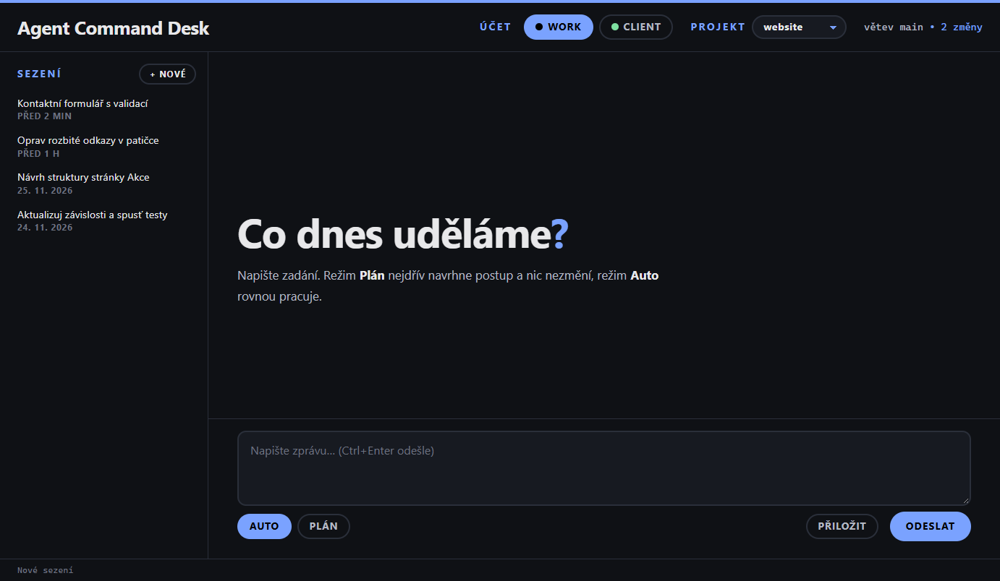
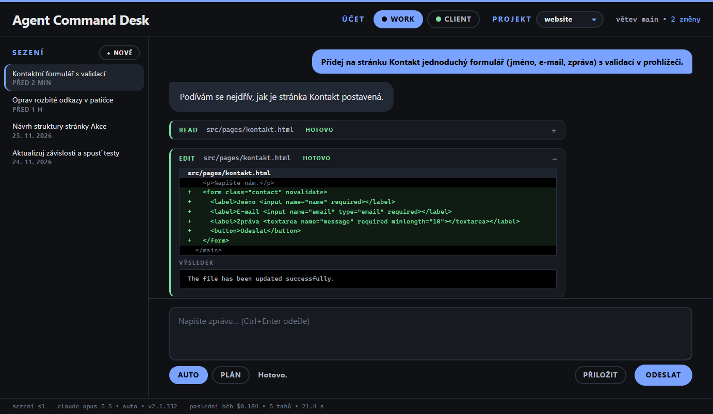
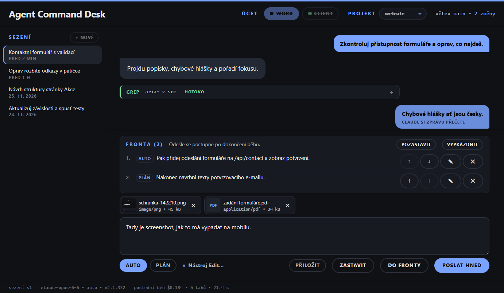
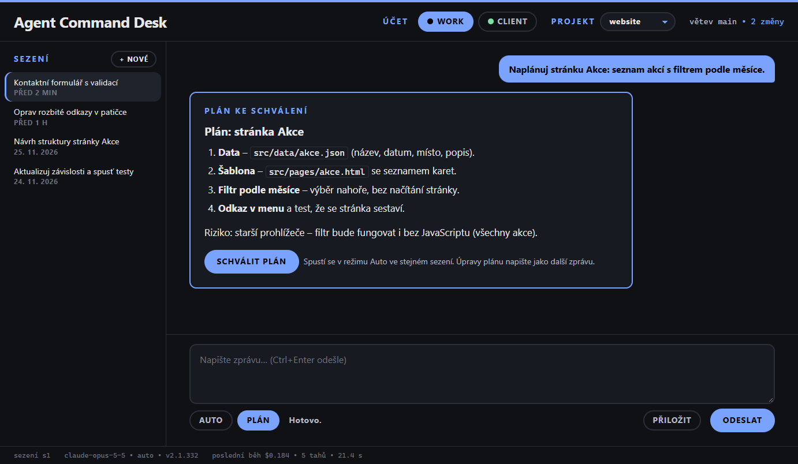

# Agent Command Desk

[English](README.md) · **Česky**

> **Chcete, aby aplikaci nainstaloval Claude Code?** Pošlete mu tento soubor (nebo [README.md](README.md)) – všechno,
> co potřebuje (na co se vás zeptat, jaký soubor vytvořit, jak to ověřit a jak změnit barvy), je v části
> [Instalace přes Claude Code](#instalace-přes-claude-code).

Malé lokální okno nad **Claude Code**, které funguje jako terminál a ukazuje víc. Vyberete povolený účet a projekt,
píšete si s Claudem se streamovanými odpověďmi, vidíte každé volání nástroje i každého agenta, kterého Claude spustí,
živý seznam úkolů s průběhem a odhadem času, nejdřív plánujete a schválíte jedním tlačítkem, režim i model přepínáte za
běhu, posíláte zprávy do běžícího tahu, řadíte další do fronty, vracíte soubory a přikládáte screenshoty nebo PDF.

Bez závislostí – jen vestavěné moduly Node.js, okno Chrome a oficiální `claude` CLI, ve kterém už jste přihlášení.
Běží na Windows a macOS (experimentálně). Rozhraní je **česky i anglicky** – přepíná se v *Nastavení → Jazyk*; výchozí je čeština.

> Nejde o produkt Anthropicu. „Claude“ je ochranná známka Anthropicu. Aplikace spouští nezměněný program `claude` pod
> vaším přihlášením a nikdy nečte ani neukládá přihlašovací údaje.



| Konverzace s kartami nástrojů a diffem | Claude pracuje: zpráva poslaná za běhu, fronta, přílohy |
|---|---|
|  |  |

| Plán čekající na schválení |
|---|
|  |

## Funkce

### Konverzace
- **Chat s Claude Code** – streamované odpovědi, karty nástrojů (Edit/MultiEdit/Write jako barevné diffy, příkazy,
  výsledky, obrázky třeba ze snímků obrazovky), jasné štítky „zamítnuto“; *Kopírovat* pod každou odpovědí ji zkopíruje
  jako Markdown.
- **Režimy** – **Auto**, **Plán** (napíše plán a nic nezmění; *Schválit plán* pokračuje v Autu ve stejném sezení,
  *Připomínkovat* umožní komentovat řádky plánu a pošle komentáře zpět), **Úpravy** (úpravy souborů bez ptaní, příkazy se
  ptají) a **Ručně** (ptá se před každou úpravou a příkazem; vyžaduje `interactivePermissions`).
- **Model a effort** – tlačítko *Model* nabízí předvolby (*Rychlé* = Sonnet + nízký effort, *Běžná práce* = výchozí
  model účtu, *Důkladné* = Opus + vysoký effort) nebo libovolný povolený model a úroveň effortu, pamatuje se pro každý
  účet. Patička ukazuje model, který Claude Code skutečně použil.
- **Poslat hned a fronta** – během práce *Poslat hned* předá zprávu do běžícího tahu (Claude si ji přečte při dalším
  kroku, jako v terminálu); *Do fronty* zprávy drží do konce běhu a pak je posílá jednu po druhé. Jde měnit pořadí
  (šipky nebo tažení za ⠿), upravit, vrátit do pole pro psaní (↩), odebrat, pozastavit. Zastavení, chyba, limit účtu
  nebo plán čekající na schválení frontu pozastaví.
- **Přílohy** – přetažení myší, screenshot vložený Ctrl+V nebo *Přiložit*: obrázky, PDF a textové soubory; typ se ověřuje
  podle obsahu, velikost je omezená, ukládají se mimo repozitář a po 7 dnech se mažou.
- **`/` a `@` v poli pro psaní** – `/` nabídne vaše příkazy a skilly s popisem a nápovědou k parametrům, `@` nabídne
  soubory projektu (Claude Code soubor načte rovnou).
- **Drží se u výstupu** – konverzace zůstává dole, dokud Claude píše, pokud nescrollujete výš (pak se objeví *↓ Na
  konec*); pole pro psaní roste s textem.
- **Hledání** – Ctrl+F hledá v konverzaci (bez ohledu na diakritiku a velikost písmen; shody ve sbalených kartách je
  rozbalí).
- **Pohodlné psaní** – seznamy se na Enter dopisují, Shift+Enter je obyčejný nový řádek; nedopsané zprávy se pamatují
  u každého sezení.

### Jako Claude Code v terminálu
| Terminál | V aplikaci |
|---|---|
| Esc | *Zastavit* přeruší; sezení zůstane připravené, další zpráva odpoví hned |
| Shift+Tab, `/model` | režim a model jde přepnout za běhu |
| Ctrl+T (seznam úkolů) | panel **Průběh** vpravo: vlastní seznam úkolů Clauda, aktuální krok, %, zbývající čas |
| subagenti | každý má jednu **kartu agenta** – úkol, typ, stav, nástroje, tokeny, čas; po rozbalení živě vidíte, co dělá |
| Ctrl+B (na pozadí) | seznam **Na pozadí** s příkazy a agenty na pozadí a tlačítkem *Zastavit* |
| `/context`, `/compact` | v patičce *Kontext 42 %* s rozpisem a *Zhustit* |
| Esc Esc, `/rewind` | ↶ u vaší zprávy vrátí soubory projektu do stavu před ní (nejdřív se ukáže seznam souborů) |
| otázky s možnostmi | karta s volbami a vlastní odpovědí (vyžaduje `interactivePermissions`) |
| žádosti o svolení | karty *Povolit jednou / Povolit vždy / Zamítnout*, úpravy jako diff (vyžaduje `interactivePermissions`) |
| `/btw` | *Bokem* – otázka odpovězená z kontextu sezení v režimu Plán, nikdy se neuloží (rozepsaná zpráva se do ní přesune) |
| `--fork-session` | ⑂ pokračovat v kopii sezení; původní zůstane nedotčené |
| `/rename` | ✎ přejmenuje sezení přímo v Claude Code (název uvidíte i v terminálu) |
| `/resume` | seznam sezení s hledáním ve vašich i Claudových zprávách; sezení otevřená v terminálu jsou označená |
| `/mcp` | MCP servery a jejich stav v *Přehledu sezení*; selhaný server se připomene v chatu |
| `/export` | *Exportovat* uloží konverzaci jako Markdown |

### Změny a soubory
- **Změny v gitu (jen čtení)** – klik na větev v hlavičce: změněné soubory rozdělené na konflikty, připravené, změněné
  a nové, s barevným diffem. Klikněte na řádek (nebo na něm stiskněte Enter) a napište komentář; *Vložit do zprávy*
  z komentářů složí jednu zprávu pro Clauda. Z aplikace nejde nic přidat do indexu, commitnout ani pushnout.
- **Soubory projektu (jen čtení)** – *Soubory*: plochý seznam nebo složky (*Seznam* / *Složky*), hledání podle názvu
  nebo cesty, náhled se zvýrazněním syntaxe, vložení cesty nebo zkopírování obsahu. Jen to, co sleduje git, plus nové
  soubory; soubory s klíči, certifikáty a `.env` se nikdy neukazují.
- **Přehled sezení** – *Přehled sezení* v patičce: soubory, které Claude upravil (i agenti), seznam úkolů, agenti a
  jejich stav, použité nástroje, MCP servery.

### Spotřeba a limity
- **Statistiky** – tlačítko *Statistiky* v patičce (nebo Ctrl+K → *Statistiky v čase*): tokeny, tahy, čas a odhad ceny
  API za poslední běh a sezení, odděleně od **limitu předplatného** (okna 5 hodin a 7 dní). *Historie a grafy*: po dnech
  podle projektu, modelu nebo účtu, využití limitu v čase, tabulka a export do CSV (ukládají se jen čísla, 180 dní).
- **Více účtů** – upozornění, když se účet blíží limitu; když ho dosáhne, jedním kliknutím přepnete na jiný účet a zprávu
  pošlete znovu. Jinak aplikace **sama pokračuje** minutu po obnovení limitu (okno musí být otevřené, jde zrušit,
  nejvýš 3 pokusy).
- **Rychlé navázání** – po odpovědi Claude Code chvíli běží dál, takže další zpráva v sezení začne bez spouštění
  (asi 0,8 s místo 3 s u krátké odpovědi), i po změně režimu nebo modelu.

### Orchestrace agentů (volitelná)
- **Vypnuto / Auto** pro každé sezení v nabídce modelu (výchozí pro nová sezení v Nastavení → *Zprávy a práce*, uloží
  se do `local/config.json`). **Vypnuto** (výchozí) je obyčejný Claude Code s jedním agentem: žádné pokyny navíc, žádní
  pracovníci. V režimu **Auto** zůstává zvolený model orchestrátorem a sám rozhoduje, zda práci svěří pracovníkovi,
  kterému a co pustí souběžně; malé úkoly řeší sám.
- **Pracovníci** jsou nativní subagenti Claude Code předaní přes `--agents <soubor>` (žádný vlastní běh agentů, žádné
  Agent Teams): `acd-explore` (Haiku, průzkum jen pro čtení), `acd-plan` (Haiku, podklady pro plán jen pro čtení),
  `acd-implementer` (Sonnet, ohraničená implementace s nástroji sezení) a `acd-reviewer` (Sonnet, kontrola jen pro čtení).
  Modely, vypnutí i vlastní pracovníky jen pro čtení jde nastavit v `orchestration.workers` (viz `config.example.json`);
  neplatné položky se vynechají s varováním v chatu. Agenta uživatele nebo projektu se stejným jménem aplikace nezastíní.
- **Karty** ukazují model pracovníka, když je známý (`Agent · Haiku · …`), agent spuštěný agentem má vlastní kartu
  uvnitř karty rodiče a *Statistiky* ukazují poslední běh po modelech (hlavní konverzace + pracovníci) i jednotlivé pracovníky.
- **Spotřeba:** pracovníci čerpají **stejné limity Claude** jako hlavní konverzace. Auto se snaží zbytečně nedelegovat,
  ale neslibuje méně tokenů.
- **Hranice:** potřebuje Claude Code **2.1.281** nebo novější (starší verze běží bez orchestrace a řeknou to).
  Přepnutí platí od další zprávy a spustí pro sezení nový proces Claude Code (jako změna effortu). Kopie a otázky
  bokem běží vždy bez orchestrace.

### Okno a bezpečnost
- **Účty s allowlistem** – každý účet je vlastní konfigurační složka Claude Code s očekávaným e-mailem, ověřeným přes
  `claude auth status`; jiné přihlášení (třeba osobní účet) nejde použít, ani omylem.
- **Projekty a účty v *Nastavení*** – přidání, přejmenování a odebrání projektů a volba výchozího; přidání a odebrání
  účtů (název, e-mail, složka Claude Code, barva). Nový účet se použije, až je ta složka přihlášená přesně zadaným
  e-mailem – *Příkaz pro přihlášení* zkopíruje příkaz pro terminál, pak napište `/login`.
- **Claude in Chrome** (volitelné, jen s `interactivePermissions`) – zaškrtávátko v panelu *Model* dovolí Claudovi
  ovládat váš Chrome přes rozšíření Claude in Chrome; každou akci v prohlížeči schvalujete v okně.
- **Oznámení** – když Claude doběhne, ptá se, čeká plán nebo se narazí na limit a okno je na pozadí.
- **Klávesnice a čtečky obrazovky** – všechno jde ovládat klávesnicí; zprávy, chyby, plány, otázky a žádosti o svolení
  se hlásí čtečce; zkontrolováno nástrojem axe-core (WCAG 2.2 AA) v obou motivech.
- **České nebo anglické rozhraní** – *Nastavení → Jazyk*; okno se znovu načte, rozepsané zprávy zůstanou. Volba platí pro daný prohlížeč.
- **Světlý nebo tmavý motiv**, **vlastní název a vzhled** (jedna hodnota v configu a jeden soubor CSS, viz *Přizpůsobení*).
- **Bezpečnost** – jen loopback, token na jedno spuštění, kontrola Host/Origin, přísné CSP; režimy oprávnění `auto`,
  `plan`, `acceptEdits` (a `default` se zapnutými žádostmi o svolení; nikdy `bypassPermissions` ani `dontAsk`);
  `claude` se spouští jen přes spawn s polem argumentů. Podrobnosti v [docs/security.md](docs/security.md).

### Klávesy
| Klávesy | Akce |
|---|---|
| Ctrl+K | Paleta příkazů (příkazy, skilly, agenti, akce aplikace, nedávné zprávy) |
| `/` · `@` na začátku slova | Nabídka příkazů a skillů · souborů projektu |
| Ctrl+F | Hledání v konverzaci (Enter / Shift+Enter nebo F3 / Shift+F3 = další / předchozí, Esc zavře) |
| Ctrl+Enter | Odeslat; během práce: poslat hned do běžícího tahu |
| Ctrl+Shift+Enter | Během práce: přidat do fronty |
| Enter / Shift+Enter | Nový řádek, který dopíše seznam / obyčejný nový řádek |
| Ctrl+V | Vložit text, nebo screenshot jako přílohu |
| Esc | Zavřít dialog, lištu hledání nebo nabídku |

## Požadavky
- **Windows 10/11** nebo **macOS** (macOS je *experimentální*: pokrytý testy v CI, ručně zatím nevyzkoušený).
- Node.js ≥ 22 a Google Chrome.
- Claude Code nainstalovaný nativním instalátorem (`~/.local/bin/claude` nebo `%USERPROFILE%\.local\bin\claude.exe`).
  Na Windows se npm zástupce `claude.cmd` záměrně odmítá (bez shellu); nastavte `claudeExe` na skutečný `.exe`.

## Nastavení
1. **Naklonujte** repozitář kamkoli: `git clone https://github.com/Polik9000/agent-command-desk.git`
2. **Každému účtu dejte vlastní konfigurační složku Claude Code** a jednou se přihlaste:
   - Windows – vytvořte `%USERPROFILE%\bin\claude-work.cmd`:
     ```bat
     @echo off
     set CLAUDE_CONFIG_DIR=%USERPROFILE%\.claude-work
     claude %*
     ```
     pak spusťte `claude-work` a napište `/login`.
   - macOS – do `~/.zshrc` přidejte `alias claude-work='CLAUDE_CONFIG_DIR=$HOME/.claude-work claude'`, pak `claude-work` → `/login`.

   Vlastní složka se doporučuje i pro jediný účet (`CLAUDE_CONFIG_DIR=~/.claude` *není* totéž co výchozí nastavení a
   žádalo by o nové přihlášení).
3. **Konfigurace:** zkopírujte `config.example.json` do `local/config.json` a upravte účty (id, label, `configDir`,
   `expectedEmail`, barva `accent`) a projekty (id, label, `path`). Cesty mohou používat `~`, `%VAR%` nebo `$VAR` a každá
   může být pro konkrétní platformu: `{ "win32": "...", "darwin": "..." }`. Volitelné klíče:

   | Klíč | Význam |
   |---|---|
   | `interactivePermissions` | `true` = karty svolení, otázky s možnostmi, režim *Ručně* a Claude in Chrome. Ve výchozím stavu vypnuto: na co by se Claude Code zeptal, to se samo zamítne. **Doporučeno `true`.** |
   | `appendSystemPrompt` | text přidaný k systémovému promptu Claude Code (`{appName}` se nahradí); vzor v příkladu říká Claudovi, že běží v této aplikaci a smí klást otázky s možnostmi |
   | `models` | modely nabízené ve výběru, např. `[{ "id": "haiku", "label": "Haiku" }, { "id": "sonnet", "label": "Sonnet" }, { "id": "opus", "label": "Opus" }]` (výchozí pořadí: Haiku, Sonnet, Opus, Fable – od nejrychlejšího po nejschopnější) (`id` = alias nebo celý název pro `claude --model`; výchozí model účtu `""` se přidá vždy) |
   | `sessionProcessMinutes` | jak dlouho Claude Code běží po odpovědi (výchozí 10; `0` = nový proces pro každou zprávu) |
   | `startFullscreen` | `true` = otevřít okno na celou obrazovku |
   | `claudeExe`, `gitExe`, `browserExe`, `stateDir`, `disallowedTools` | cesty a zakázané nástroje |

   Server přijímá jen nastavené modely a úrovně effortu `low`, `medium`, `high`, `xhigh`, `max`.
4. **Nainstalujte spouštěč:**
   - Windows: `powershell -ExecutionPolicy Bypass -File scripts\install.ps1` → vytvoří `%USERPROFILE%\bin\<app id>.cmd`
     (`%USERPROFILE%\bin` musí být v `PATH`).
   - macOS: `sh scripts/install.sh` → vytvoří `~/.local/bin/<app id>`.
5. **Spusťte** `agent-command-desk` (nebo vaše vlastní `app.id`) v terminálu. Server se spustí skrytě a otevře okno
   Chrome; zavřením okna se zastaví server i všechny běžící `claude`. Když aplikace už běží, spouštěč to jen oznámí –
   nejdřív zavřete okno, pak spusťte novou verzi. Logy (bez textů zpráv) jsou ve složce stavu
   (`%LOCALAPPDATA%\<app id>` / `~/Library/Application Support/<app id>`).

Pozdější aktualizace: `git pull`, zavřete okno a spusťte spouštěč znovu (složka `local/` se nikdy nemění).
Změny v `local/config.json` se také projeví až po restartu.

## Instalace přes Claude Code
Tato část je psaná pro **Claude Code (nebo jiného programovacího agenta)**, který dostal za úkol aplikaci stáhnout,
zprovoznit a upravit její vzhled. Postupujte doslova; nic z toho se nemusí hádat ani hledat v repozitáři.

**Fakta**
- Repozitář: `https://github.com/Polik9000/agent-command-desk` (větev `main`). Žádné `npm install` – nejsou žádné závislosti.
- Potřebuje Node.js ≥ 22 (`node --version`), Google Chrome a **nativní** program Claude Code: Windows
  `%USERPROFILE%\.local\bin\claude.exe`, macOS/Linux `~/.local/bin/claude` (ověřte `claude --version`; na Windows se
  `claude.cmd` z npm záměrně odmítá – nastavte `claudeExe` na skutečný `.exe`).
- Jediný soubor, který musíte vytvořit, je **`local/config.json`** (git ho ignoruje). Všechno osobní je v `local/`:
  `config.json`, `theme.css` (barvy a písma), `favicon.svg`. Nikdy neupravujte soubory mimo `local/`, nikdy
  necommitujte `local/`, nikdy nečtěte ani nevypisujte přihlašovací údaje (`.credentials.json`, `.claude.json`, tokeny),
  žádné globální instalace.
- Aplikace běží jen pro účty a projekty uvedené v `local/config.json`. Účet se použije, jen když `claude auth status`
  v jeho konfigurační složce hlásí přesně jeho `expectedEmail`.

**Kroky**
1. `git clone https://github.com/Polik9000/agent-command-desk.git <složka>` a `cd <složka>`.
2. **Zeptejte se uživatele** (jedna krátká zpráva, pak jednejte): název aplikace; u každého účtu název, e-mail a složku
   jeho přihlášení do Claude Code (např. `~/.claude-work`; každý účet potřebuje **vlastní** složku, i když je jediný);
   složky projektů; zda chce karty svolení (doporučte ano); hlavní barvu každého účtu (hex) a případně barvy a písma, má-li
   mít vlastní vzhled.
3. Vytvořte `local/config.json` podle `config.example.json` (JSON, komentáře nejsou povolené):
   ```json
   {
     "app": { "id": "my-desk", "name": "My Desk" },
     "interactivePermissions": true,
     "appendSystemPrompt": "<zkopírujte hodnotu z config.example.json>",
     "defaultAccount": "work",
     "accounts": [
       { "id": "work", "label": "Práce", "configDir": "~/.claude-work", "expectedEmail": "me@example.com", "accent": "#7aa2ff" }
     ],
     "defaultProject": "site",
     "projects": [ { "id": "site", "label": "Web", "path": "~/code/site" } ]
   }
   ```
   `app.id` = malá písmena, číslice a pomlčky (stane se příkazem spouštěče a názvem složky stavu). Cesty berou `~`,
   `%VAR%`, `$VAR` nebo `{ "win32": "…", "darwin": "…", "linux": "…" }` pro jednotlivé platformy. Složky projektů by měly
   existovat (chybějící se v přepínači projektů označí). Další klíče jsou v tabulce v části *Nastavení*.
4. **Přihlášení je krok uživatele** (otevírá prohlížeč): u nové složky mu dejte příkaz a počkejte – PowerShell
   `$env:CLAUDE_CONFIG_DIR = "$HOME\.claude-work"; claude`, macOS/Linux `CLAUDE_CONFIG_DIR=~/.claude-work claude`,
   pak `/login` se správným účtem. Nezkoušejte se přihlásit sami.
5. **Kontrola:** `node src/server/server.mjs --info` musí vypsat JSON (název, id, složka stavu); chybová hláška pojmenuje
   přesný problém v configu – opravte a zopakujte. Potom `npm test` (asi 120 testů, skutečný `claude` není potřeba).
6. **Nainstalujte spouštěč** (vytvoří jeden malý soubor, nic jiného): Windows `powershell -ExecutionPolicy Bypass -File
   scripts\install.ps1` → `%USERPROFILE%\bin\<app.id>.cmd` (když skript upozorní, řekněte uživateli, ať přidá
   `%USERPROFILE%\bin` do `PATH`); macOS/Linux `sh scripts/install.sh` → `~/.local/bin/<app.id>`.
7. **Spuštění:** v terminálu `<app.id>`. Otevře se okno Chrome; čipy účtů musí ukazovat ověřené účty. Když u některého
   stojí *nepřihlášen*, není pro něj hotový krok 4; špatný e-mail se ohlásí i s nalezeným e-mailem.
8. Pozdější aktualizace: `git pull`, zavřít okno a spustit znovu. Změny v `local/config.json` a `local/theme.css`
   potřebují restart nebo obnovení okna.

**Změna barev a vzhledu** (vytvořte `local/theme.css`; načítá se po výchozích hodnotách, uvádějte jen to, co se mění)
- Vyjděte z kopie `src/server/wwwroot/theme.css` (všechny proměnné jsou tam popsané). Hodnoty pro tmavý motiv dejte do
  `:root { … }`, pro světlý do `:root[data-theme="light"] { … }` – vlastní vzhled potřebuje oba.
- Proměnné: `--bg` pozadí stránky, `--fg` text, `--gray-1` panely a pole, `--gray-2` zvýraznění a najetí, `--gray-3`
  popisky, `--bubble` bublina odpovědi, `--text-muted`, `--line` okraje, `--code-bg` kód a diffy, `--on-accent` text na
  akcentu, `--ok` `--info` `--err` stavové barvy, `--hl-keyword` `--hl-string` `--hl-number` `--hl-title` barvy kódu,
  písma `--font-head` `--font-body` `--font-mono`, značka `--brand-suffix` `--title-suffix` `--motif-short`
  `--motif-fill` `--spinner`.
- **Akcent** se nastavuje pro každý účet klíčem `accent` v `local/config.json`, ne v CSS (barví tlačítka, čipy a vaše
  bubliny a mění se podle zvoleného účtu). Ve světlém motivu se akcent používá i pro text, proto `--accent-ink` (výchozí:
  ztmavený akcent) drží čitelnost – přepište ho, je-li akcent velmi světlý.
- Kontrast textu a pozadí držte aspoň 4,5:1 v obou motivech (rozhraní se kontroluje nástrojem axe-core na WCAG 2.2 AA).
- Písma: do `local/theme.css` přidejte pravidla `@font-face` se soubory z `local/` (jen písma, jejichž licence to
  dovoluje); repozitář obsahuje Bricolage Grotesque a Merriweather (OFL) v `src/server/wwwroot/fonts/`.
- Název: `app.name` v configu (titulek a logo); ikona: `local/favicon.svg`.

## Přizpůsobení
Všechno osobní je v `local/` (git ho ignoruje):

| Soubor | Co |
|---|---|
| `local/config.json` | `app.id` (název spouštěče a složky stavu), `app.name` (titulek okna a logo), účty, projekty, volitelně `orchestration` (výchozí režim, modely pracovníků) |
| `local/theme.css` | váš vzhled: zkopírujte `src/server/wwwroot/theme.css` a změňte barvy, písma (`@font-face`), příponu značky, motiv, spinner, posuvníky; světlé barvy patří do bloku `:root[data-theme="light"]` (`--accent-ink` = akcent použitý pro text a čáry) |
| `local/favicon.svg` | vaše ikona |

Hotový prompt pro Claude Code (nahraďte části v závorkách):

```text
Naklonuj https://github.com/Polik9000/agent-command-desk do [~/code/agent-command-desk] a přečti README.cs.md
(část „Instalace přes Claude Code“). Vytvoř local/config.json z config.example.json: název aplikace „[Můj Desk]“,
účet „[Práce]“ se složkou [~/.claude-work] a e-mailem [me@example.com], projekty [~/code/web, ~/code/app],
"interactivePermissions": true. Vytvoř local/theme.css ze src/server/wwwroot/theme.css v mé značce: barvy [#123456 …],
písma [… – woff2 soubory dej do local/ jen pokud to licence dovoluje] a local/favicon.svg.
Soubory vytvářej jen uvnitř local/, nic jiného neměň a necommituj. Pak spusť npm test a instalační skript.
```

## Jak aplikace řídí Claude Code
Jeden proces `claude -p --input-format stream-json --output-format stream-json` na sezení, ponechaný pro další zprávu.
Aplikace s ním mluví vlastními řídicími požadavky Claude Code (přerušení, režim oprávnění, model, zaplnění kontextu,
návrat souborů, úlohy na pozadí) a jeho proud mění na karty popsané výše. Seznam úkolů Claude Code a kontrolní body
souborů jsou pro tyto procesy zapnuté. Podrobnosti: [docs/claude-code-headless.md](docs/claude-code-headless.md).

## Vývoj
```
npm test        # ~120 testů: parser proudu, runner s falešným claude (řídicí požadavky, přerušení, kopie), config, nastavení, git, soubory, sezení, historie spotřeby, oprávnění, fronta, 401/403/CSP
npm run check   # kontrola syntaxe
ACD_OPEN_BROWSER=0 node src/server/server.mjs   # vypíše adresu s tokenem na interaktivní konzoli
```
Testy nepotřebují skutečný `claude`; CI je spouští na Windows, macOS i Linuxu.
Proměnné prostředí jen pro testy: `ACD_CONFIG`, `ACD_TOKEN` (≥ 32 znaků), `ACD_PORT`, `ACD_OPEN_BROWSER`.
Texty: ve skriptech se píší česky jako `_t('Česká věta {0}', arg)`, anglický překlad patří do `src/server/wwwroot/i18n.en.js` pod stejným klíčem (`tests/i18n.test.mjs` selže, když chybí nebo mají různé `{n}`). Statické HTML se překládá podle přesného textu, hlášky serveru funkcí `_tr()`.
Knihovny a volitelná písma: `scripts/fetch-vendor.ps1` (pevné verze, viz `src/server/wwwroot/vendor/VERSIONS.md`).

## Plán
Nápady a zpětná vazba vítány – otevřete issue.

## Odinstalace
Windows: `powershell -ExecutionPolicy Bypass -File scripts\uninstall.ps1` · macOS: `sh scripts/uninstall.sh`.
Odstraní spouštěč a složku stavu; účty Claude Code a repozitář zůstanou. Složku repozitáře smažte sami.

## Licence
[MIT](LICENSE) © 2026 Tobias Otta. Přibalený kód třetích stran a písma mají vlastní licence.
