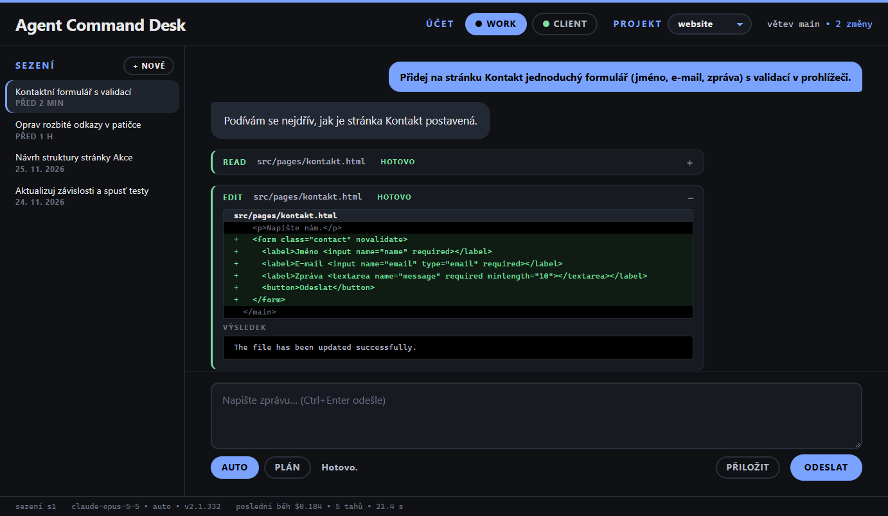
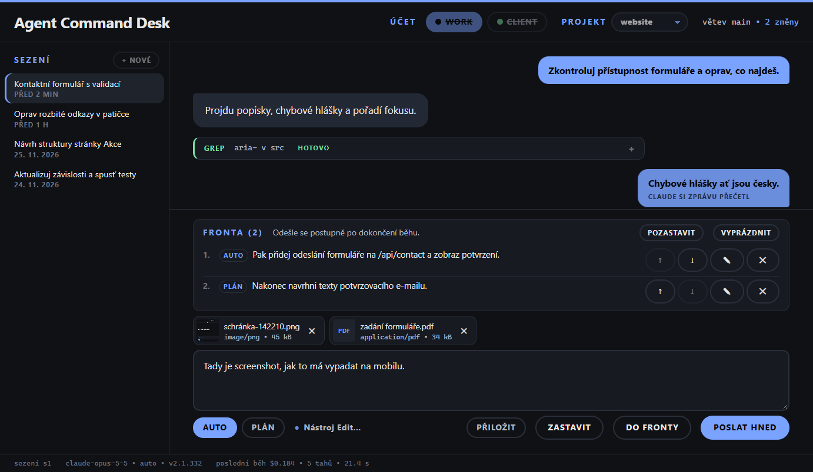
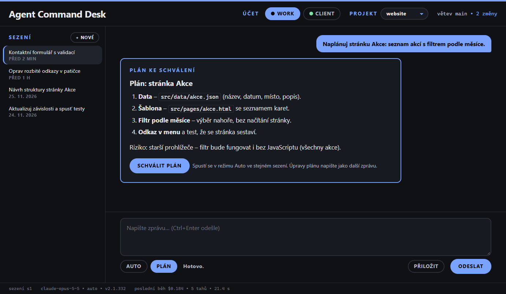

# Agent Command Desk

A small local desktop window for **Claude Code**. Pick an allowlisted account and project, chat with streamed answers,
see every tool call (edits as diffs), plan first and approve with one click, send messages while Claude works, queue the
next ones and attach screenshots or PDFs.

No dependencies – just Node.js built-ins, a Chrome app window and the official `claude` CLI you are already logged into.
Runs on Windows and macOS (experimental). The UI is in Czech.

> Not affiliated with Anthropic. "Claude" is a trademark of Anthropic. The app runs the unmodified `claude` binary under
> your own login and never reads or stores credentials.


| Conversation with tool cards and a diff | Claude working: message sent mid-run, queue, attachments |
|---|---|
|  |  |

| Plan waiting for approval |
|---|
|  |

## Features
- **Chat with Claude Code** – streamed answers, tool cards (Edit/MultiEdit/Write shown as diffs, Bash commands, results),
  clear "denied" badges, model and cost of the last run in the footer.
- **Accounts with an allowlist** – each account is a separate Claude Code config directory with an expected e-mail,
  verified via `claude auth status`. Any other login (e.g. a personal account) cannot be used, not even by mistake.
- **Projects** – only allowlisted folders; git branch and number of changes shown in the header.
- **Git changes (read-only)** – click the branch/changes in the header: changed files grouped as conflicts, staged,
  changed and new, with a coloured diff per file (new text files shown as added). Nothing can be staged, committed or
  pushed from the app.
- **Auto / Plan** – Plan writes a plan and changes nothing; **Approve plan** continues in Auto in the same session.
- **Model and effort** – the *Model* button next to Auto/Plan offers presets (*Rychlé* = Sonnet + low effort,
  *Běžná práce* = account default, *Důkladné* = Opus + high effort) or any allowlisted model and effort level. The choice
  is remembered per account, applies from the next message (also inside a running session) and queued messages keep
  theirs. The footer shows the model Claude Code actually used; effort is marked *požadováno* (requested) because the
  CLI does not report it back.
- **Sessions** – list with history, resume any session, Stop kills the whole process tree. Search across your and
  Claude's messages in the account's and project's sessions (case and diacritics ignored, matching snippet shown) and
  rename sessions with ✎ (the name is stored in the app only; Claude Code's transcripts are never modified).
- **Fast follow-ups** – after a reply Claude Code keeps running for a while, so the next message in the same session
  (same mode and model) is answered without start-up – about 0.8 s instead of 3 s for a short reply.
- **Send now** – while Claude works, *Poslat hned* passes your message into the running turn; Claude picks it up at the
  next step (like in the Claude Code terminal) and the message shows when it was read.
- **Message queue** – *Do fronty* keeps messages until the run finishes, then sends them one by one to the same session.
  Reorder (arrows or drag the ⠿ handle), edit, remove, pause. Stop, an error, a usage limit or a plan waiting for approval
  pauses the queue – nothing is sent on its own after an interruption.
- **Attachments** – drag & drop into the window, paste a screenshot with Ctrl+V or use *Přiložit*. Images (png, jpg, gif,
  webp), PDF and text files (txt, md, csv, json, log); type checked by content, size limited, stored outside the repo and
  deleted after 7 days. Claude can read only the current account's and project's attachment folder.
- **Command palette** (Ctrl+K or *Příkazy*) – your custom commands and skills (learned from the first run in a project),
  app actions (new session, Auto/Plan, model presets, git changes, settings, full screen) and recent messages; type to
  filter (diacritics ignored), Enter inserts `/command ` into the message. Recent messages are kept in memory only.
  Typing `/` at the start of a message suggests the same commands and skills right in the text box.
- **Project files** (*Soubory*) – read-only file finder and viewer with syntax highlighting: search by name or path,
  insert the path into your message, copy the content. Lists what git tracks plus new files (nothing ignored by
  `.gitignore`), outside git it skips build and cache folders; key, certificate and `.env` files are never shown.
- **Comment on the diff** – in the git view (click the branch in the header) click a changed line, or press Enter on it
  (arrow keys move between lines), and write what Claude should change. *Vložit do zprávy* turns all comments into one
  message (file, line number, the code, your note) that you review and send. Comments live in the window's memory only.
- **Session overview** (*Přehled sezení* in the footer) – files Claude edited (also by subagents; click to open in the
  file viewer), the latest to-do list, agents and their state, tools used, and **MCP servers** with their connection state
  as Claude Code reports it at start (connected / failed / needs sign-in). Read from the session transcript only; a
  failed MCP server is also noted in the chat.
- **Copy and find** – *Kopírovat* under every reply copies it as Markdown; Ctrl+F finds text in the conversation
  (diacritics and case ignored, Enter / Shift+Enter next / previous, matches in collapsed tool cards open them).
- **Comfortable typing** – Enter after `1. item`, `- item` or `- [ ] item` continues the list, Enter on an empty item ends
  it, Shift+Enter is a plain new line.
- **Settings** (*Nastavení* in the header) – add, rename and remove projects without editing JSON (the folder must
  exist; drive roots, your home folder and Claude Code account folders are refused; the previous config is kept as
  `config.json.bak`). Accounts are listed read-only: they are changed only by hand in `local/config.json`, so the UI can
  never add an unverified (e.g. personal) account. Full-screen toggle (or F11) and notification options.
- **Notifications** (optional, footer toggle or *Settings*) – when Claude finishes, a plan waits or a limit is hit while the window is
  in the background; the window title gets a ● marker.
- **Statistics** (click the last run in the footer) – tokens (input, output, cache read/write), turns, time and the
  API-price estimate for the last run and the session, kept apart from your **subscription limit** (5-hour and 7-day
  windows with usage and reset time, as reported by Claude Code). In memory only.
- **Permission requests** (optional, `"interactivePermissions": true`) – when Claude Code would ask for permission,
  a card in the chat offers *Povolit jednou* (allow once), *Povolit vždy* (allow always: saves the rule Claude Code
  suggests, e.g. `Bash(npm test *)`, to the project's `.claude/settings.local.json`, like the terminal does) and
  *Zamítnout* (deny). No answer in 10 minutes = deny. Off by default: then anything that would ask is denied
  automatically. In Auto mode Claude Code asks only rarely, so this also adds a third mode, *Ručně* (manual, Claude
  Code's `default` mode): Claude Code asks before every file edit and command.
- **Usage limits** – warning when an account gets close; when it hits the limit, one click switches to another account
  and resends.
- **Keyboard and screen readers** – everything works from the keyboard (Ctrl+K, Ctrl+Enter, Esc closes dialogs and
  returns focus), messages are labelled *Vaše zpráva* / *Claude*, errors, plans and permission requests are announced;
  a permission card never steals focus while you type. Checked with axe-core (WCAG 2.2 AA) in both themes.
- **Light or dark** – *Nastavení → Vzhled*: dark (default), light, or follow the system. Remembered per browser.
- **Your own name and look** – one config value and one CSS file (see *Customize*).
- **Security** – loopback only, per-launch token, Host/Origin checks, strict CSP, permission mode only `auto` or `plan`
  (plus `default` with permission requests on; never `bypassPermissions`). Details in [docs/security.md](docs/security.md).

### Keyboard
| Keys | Action |
|---|---|
| Ctrl+K | Command palette |
| Ctrl+F | Find in the conversation (Enter / Shift+Enter or F3 / Shift+F3 = next / previous, Esc closes) |
| Ctrl+Enter | Send; while Claude works: send now into the running turn |
| Ctrl+Shift+Enter | While Claude works: add to the queue |
| Enter | New line; continues a numbered/bulleted list |
| Shift+Enter | Plain new line (no list continuation) |
| Ctrl+V | Paste text, or a screenshot as an attachment |
| Ctrl+Enter / Esc (editing a queued message) | Save / cancel |

## Requirements
- **Windows 10/11** or **macOS** (macOS is *experimental*: covered by CI tests, not yet tried by hand).
- Node.js ≥ 22 and Google Chrome.
- Claude Code installed with the native installer (`~/.local/bin/claude` or `%USERPROFILE%\.local\bin\claude.exe`).
  On Windows the npm `claude.cmd` shim is rejected on purpose (no shell); set `claudeExe` to a real `.exe` instead.

## Setup
1. **Clone** the repo anywhere: `git clone https://github.com/Polik9000/agent-command-desk.git`
2. **Give each account its own Claude Code config directory** and log in once:
   - Windows – create `%USERPROFILE%\bin\claude-work.cmd`:
     ```bat
     @echo off
     set CLAUDE_CONFIG_DIR=%USERPROFILE%\.claude-work
     claude %*
     ```
     then run `claude-work` and type `/login`.
   - macOS – add `alias claude-work='CLAUDE_CONFIG_DIR=$HOME/.claude-work claude'` to `~/.zshrc`, then `claude-work` → `/login`.

   A dedicated folder is recommended even for a single account (`CLAUDE_CONFIG_DIR=~/.claude` is *not* the same as the
   default setup and would ask you to log in again).
3. **Configure:** copy `config.example.json` to `local/config.json` and edit accounts (id, label, `configDir`,
   `expectedEmail`, `accent` colour) and projects (id, label, `path`). Paths may use `~`, `%VAR%` or `$VAR`, and any path
   can be per-platform: `{ "win32": "...", "darwin": "..." }`. Optional: `claudeExe`, `gitExe`, `browserExe`, `stateDir`,
   `disallowedTools`, `appendSystemPrompt` (`{appName}` is replaced), `models` – the models offered in the picker
   (`id` is an alias or full model name passed to `claude --model`; `""` = the account's default is always added):
   ```json
   "models": [{ "id": "opus", "label": "Opus" }, { "id": "sonnet", "label": "Sonnet" }, { "id": "fable", "label": "Fable" }]
   ```
   The server accepts only these ids and the effort levels `low`, `medium`, `high`, `xhigh`, `max`.
   `"startFullscreen": true` opens the window in full screen. `"interactivePermissions": true` turns on permission
   requests in the window (see *Features*). `"sessionProcessMinutes": 10` = how long Claude Code stays running after a
   reply so the next message in the session starts instantly (`0` = new process for every message).
   Projects can also be managed later in the app (*Nastavení*).
4. **Install the launcher:**
   - Windows: `powershell -ExecutionPolicy Bypass -File scripts\install.ps1` → creates `%USERPROFILE%\bin\<app id>.cmd`
     (make sure `%USERPROFILE%\bin` is on `PATH`).
   - macOS: `sh scripts/install.sh` → creates `~/.local/bin/<app id>`.
5. **Run** `agent-command-desk` (or your own `app.id`). The server starts hidden and opens a Chrome app window;
   closing the window stops the server and any running `claude`. Logs (without prompts) are in the state directory
   (`%LOCALAPPDATA%\<app id>` / `~/Library/Application Support/<app id>`).

To update later: `git pull`, then close the window and start the app again (your `local/` folder is never touched).

## Customize
Everything personal lives in `local/` (git-ignored):

| File | What |
|---|---|
| `local/config.json` | `app.id` (launcher and state folder name), `app.name` (window title and logo), accounts, projects |
| `local/theme.css` | your look: copy `src/server/wwwroot/theme.css` and change colours, fonts (`@font-face`), brand suffix, motif, spinner, scrollbars; light colours go in a `:root[data-theme="light"]` block (`--accent-ink` = accent used for text and lines) |
| `local/favicon.svg` | your icon |

Ready-made prompt for Claude Code (replace the parts in brackets):

```text
Clone https://github.com/Polik9000/agent-command-desk into [~/code/agent-command-desk] and read README.md.
Create local/config.json from config.example.json: app name "[My Desk]", account "[Work]" with config dir
[~/.claude-work] and e-mail [me@example.com], projects [~/code/site, ~/code/app].
Create local/theme.css from src/server/wwwroot/theme.css in my brand: colours [#123456 …], fonts [… – bundle
woff2 files in local/ only if their licence allows it], and local/favicon.svg.
Only create files inside local/, do not change anything else and do not commit. Then run npm test and the install script.
```

## Development
```
npm test        # ~100 tests: stream parser, config, settings writes, git view, project files, session processes (fake claude), permissions, account guard, queue, list editing, attachments, 401/403/CSP
npm run check   # syntax check
ACD_OPEN_BROWSER=0 node src/server/server.mjs   # prints the URL with token on an interactive console
```
No real `claude` is needed for the tests; CI runs them on Windows, macOS and Linux.
Test-only environment variables: `ACD_CONFIG`, `ACD_TOKEN` (≥ 32 chars), `ACD_PORT`, `ACD_OPEN_BROWSER`.
Vendor libraries and optional fonts: `scripts/fetch-vendor.ps1` (pinned versions, see `src/server/wwwroot/vendor/VERSIONS.md`).
How the CLI is driven (stream-json input/output, sending into a running turn): [docs/claude-code-headless.md](docs/claude-code-headless.md).

## Roadmap
Ideas and feedback welcome – open an issue.

## Uninstall
Windows: `powershell -ExecutionPolicy Bypass -File scripts\uninstall.ps1` · macOS: `sh scripts/uninstall.sh`.
Removes the launcher and the state folder; your Claude Code accounts and the repo stay. Delete the repo folder yourself.

## License
[MIT](LICENSE) © 2026 Tobias Otta. Bundled third-party code and fonts keep their own licences.

---

## Česky
Malé lokální okno nad Claude Code: povolené účty a projekty, streamované odpovědi, karty nástrojů s diffem, režim Plán
se schválením jedním tlačítkem, pokračování, hledání a přejmenování sezení, volba modelu a effortu (předvolby Rychlé / Běžná práce / Důkladné,
pamatuje se pro každý účet). Během práce lze poslat zprávu hned do běžícího tahu, nebo ji dát
do fronty; přikládat jde screenshoty (Ctrl+V), PDF a textové soubory. Rozhraní je české.

**Nastavení**
1. Každý účet = vlastní složka `CLAUDE_CONFIG_DIR` (alias viz *Setup*), jednou `/login`.
2. `config.example.json` zkopírujte do `local/config.json` a vyplňte účty (včetně očekávaného e-mailu) a projekty.
   Volitelně `models` = seznam modelů nabízených ve výběru (viz *Setup*), `startFullscreen` = okno na celou obrazovku.
   Projekty jde později přidávat, přejmenovat a odebírat přímo v aplikaci (tlačítko **Nastavení**); účty jen ručně
   v configu.

Kliknutím na větev a počet změn v hlavičce se otevře **přehled změn v gitu** (soubory a diff, jen pro čtení).
Tlačítko **Soubory** otevře hledání a náhled souborů projektu (jen pro čtení; soubory s klíči a hesly se neukazují).
V přehledu změn jde kliknout na řádek a napsat k němu **komentář**; tlačítko *Vložit do zprávy* z komentářů složí zprávu
pro Clauda. **Přehled sezení** v patičce ukáže upravené soubory, seznam úkolů, agenty a stav MCP serverů. Pod každou
odpovědí je *Kopírovat*, Ctrl+F hledá v konverzaci (bez ohledu na diakritiku).
3. Vlastní název: `app.name` v configu. Vlastní vzhled: `local/theme.css` (vzor `src/server/wwwroot/theme.css`),
   ikona `local/favicon.svg`. Složka `local/` se nikdy necommituje. Světlý nebo tmavý motiv: **Nastavení → Vzhled**
   (barvy světlého motivu ve vlastním tématu: blok `:root[data-theme="light"]`).
4. Spouštěč: Windows `scripts\install.ps1`, macOS `scripts/install.sh`; pak příkaz podle `app.id`.

Nebo dejte Claudovi prompt z části *Customize* a nechte ho nastavit všechno za vás.

**Klávesy:** Ctrl+K otevře paletu příkazů (vlastní příkazy, skilly, akce, nedávné zprávy), Ctrl+F hledá v konverzaci, Ctrl+Enter odešle (během práce = poslat hned), Ctrl+Shift+Enter = do fronty, Enter v seznamu doplní další
číslo či odrážku, Shift+Enter = obyčejný nový řádek, Ctrl+V vloží screenshot jako přílohu.
