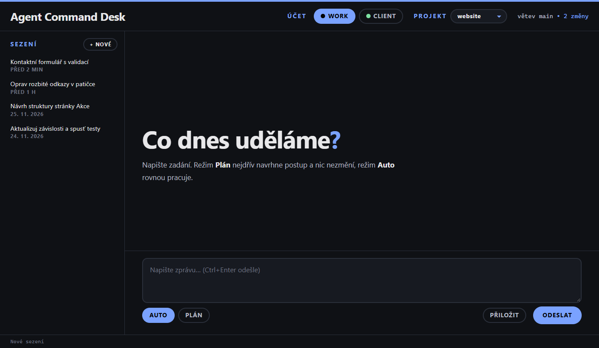

# Agent Command Desk

**English** · [Česky](README.cs.md)

> **Asking Claude Code to install this?** Point it at this file – everything it needs (what to ask you, which file to
> write, how to check it, how to change the colours) is in [Installing with Claude Code](#installing-with-claude-code).

A small local desktop window for **Claude Code** that works like the terminal and shows more. Pick an allowlisted
account and project, chat with streamed answers, watch every tool call and every agent Claude starts, see a live task
list with progress and time left, plan first and approve with one click, switch mode or model while Claude works,
send messages into a running turn, queue the next ones, rewind files, and attach screenshots or PDFs.

No dependencies – just Node.js built-ins, a Chrome app window and the official `claude` CLI you are already logged into.
Runs on Windows and macOS (experimental). The UI is in Czech.

> Not affiliated with Anthropic. "Claude" is a trademark of Anthropic. The app runs the unmodified `claude` binary under
> your own login and never reads or stores credentials.



| Conversation with tool cards and a diff | Claude working: message sent mid-run, queue, attachments |
|---|---|
|  |  |

| Plan waiting for approval |
|---|
|  |

## Features

### Conversation
- **Chat with Claude Code** – streamed answers, tool cards (Edit/MultiEdit/Write as coloured diffs, commands, results,
  images such as screenshots), clear "denied" badges; *Kopírovat* under every reply copies it as Markdown.
- **Modes** – **Auto**, **Plán** (writes a plan, changes nothing; *Schválit plán* continues in Auto in the same session,
  *Připomínkovat* lets you comment on lines of the plan and sends the comments back), **Úpravy** (file edits without
  asking, commands ask) and **Ručně** (asks before every edit and command; needs `interactivePermissions`).
- **Model and effort** – the *Model* button offers presets (*Rychlé* = Sonnet + low effort, *Běžná práce* = account
  default, *Důkladné* = Opus + high effort) or any allowlisted model and effort level, remembered per account. The footer
  shows the model Claude Code actually used.
- **Send now and queue** – while Claude works, *Poslat hned* passes your message into the running turn (Claude reads it
  at the next step, like in the terminal); *Do fronty* keeps messages until the run finishes, then sends them one by one.
  Reorder (arrows or drag ⠿), edit, return to the text box (↩), remove, pause. Stop, an error, a usage limit or a plan
  waiting for approval pauses the queue.
- **Attachments** – drag & drop, paste a screenshot with Ctrl+V or use *Přiložit*: images, PDF and text files; type
  checked by content, size limited, stored outside the repo, deleted after 7 days.
- **`/` and `@` in the text box** – `/` suggests your commands and skills with descriptions and argument hints, `@`
  suggests project files (Claude Code reads the file right away).
- **Follows the output** – the conversation stays at the bottom while Claude writes, unless you scroll up (then *↓ Na konec* appears); the message box grows with your text.
- **Find** – Ctrl+F finds text in the conversation (diacritics and case ignored; matches in collapsed cards open them).
- **Comfortable typing** – lists continue on Enter, Shift+Enter is a plain new line; unsent drafts are kept per session.

### Like the Claude Code terminal
| Terminal | In the app |
|---|---|
| Esc | *Zastavit* interrupts; the session stays ready, the next message answers at once |
| Shift+Tab, `/model` | mode and model can be switched while Claude works |
| Ctrl+T (task list) | **Průběh** panel on the right: Claude's own task list, current step, %, time left |
| subagents | one **agent card** each – task, type, state, tools, tokens, time; expand to watch live what it does |
| Ctrl+B (background) | **Na pozadí** list of background commands and agents with *Zastavit* |
| `/context`, `/compact` | footer *Kontext 42 %* with a breakdown and *Zhustit* |
| Esc Esc, `/rewind` | ↶ next to your message rewinds the project files to the state before it (file list shown first) |
| questions with options | a card with choices and your own answer (needs `interactivePermissions`) |
| permission prompts | cards *Povolit jednou / Povolit vždy / Zamítnout*, edits shown as a diff (needs `interactivePermissions`) |
| `/btw` | *Bokem* – a side question answered from the session in Plan mode, never saved (a half-written message moves into it) |
| `--fork-session` | ⑂ continue in a copy of a session; the original stays untouched |
| `/rename` | ✎ renames the session in Claude Code itself (visible in the terminal too) |
| `/resume` | session list with search across your and Claude's messages; sessions open in a terminal are marked |
| `/mcp` | MCP servers and their state in *Přehled sezení*; a failed server is noted in the chat |
| `/export` | *Exportovat* saves the conversation as Markdown |

### Changes and files
- **Git changes (read-only)** – click the branch in the header: changed files grouped as conflicts, staged, changed and
  new, with a coloured diff. Click a line (or Enter on it) to write a comment; *Vložit do zprávy* turns all comments
  into one message for Claude. Nothing can be staged, committed or pushed from the app.
- **Project files (read-only)** – *Soubory*: a flat list or folders (*Seznam* / *Složky*), search by name or path,
  view with syntax highlighting, insert the path or copy the content. Only what git tracks plus new files; key, certificate and `.env` files are never shown.
- **Session overview** – *Přehled sezení* in the footer: files Claude edited (also by agents), the task list, agents
  and their state, tools used, MCP servers.

### Usage and limits
- **Statistics** – the *Statistiky* button in the footer (or Ctrl+K → *Statistiky v čase*): tokens, turns, time and the API-price estimate for the last run and
  the session, apart from your **subscription limit** (5-hour and 7-day windows). *Historie a grafy*: per day by
  project, model or account, limit usage over time, table and CSV export (only numbers are stored, 180 days).
- **Several accounts** – a warning when an account gets close to its limit; when it hits it, one click switches to
  another account and resends. Otherwise the app **continues automatically** a minute after the limit resets (window
  open, cancellable, at most 3 tries).
- **Fast follow-ups** – after a reply Claude Code keeps running for a while, so the next message in the session starts
  without start-up (about 0.8 s instead of 3 s for a short reply), also after a mode or model change.

### Window and safety
- **Accounts with an allowlist** – each account is its own Claude Code config directory with an expected e-mail,
  verified via `claude auth status`; any other login (e.g. a personal account) cannot be used, not even by mistake.
- **Projects and accounts in *Nastavení*** – add, rename, remove projects and pick the default one; add or remove
  accounts (name, e-mail, Claude Code folder, colour). A new account is used only once that folder is logged in with
  exactly that e-mail – *Příkaz pro přihlášení* copies the terminal command, then type `/login`.
- **Claude in Chrome** (optional, only with `interactivePermissions`) – a checkbox in the *Model* panel lets Claude
  control your Chrome through the Claude in Chrome extension; every browser action needs your approval in the window.
- **Notifications** – when Claude finishes, asks, a plan waits or a limit is hit while the window is in the background.
- **Keyboard and screen readers** – everything works from the keyboard; messages, errors, plans, questions and
  permission requests are announced; checked with axe-core (WCAG 2.2 AA) in both themes.
- **Light or dark**, **your own name and look** (one config value and one CSS file, see *Customize*).
- **Security** – loopback only, per-launch token, Host/Origin checks, strict CSP; permission modes `auto`, `plan`,
  `acceptEdits` (plus `default` with permission requests on; never `bypassPermissions` or `dontAsk`); `claude` only via
  spawn with an argument array. Details in [docs/security.md](docs/security.md).

### Keyboard
| Keys | Action |
|---|---|
| Ctrl+K | Command palette (commands, skills, agents, app actions, recent messages) |
| `/` · `@` at the start of a word | Suggest commands and skills · project files |
| Ctrl+F | Find in the conversation (Enter / Shift+Enter or F3 / Shift+F3 = next / previous, Esc closes) |
| Ctrl+Enter | Send; while Claude works: send now into the running turn |
| Ctrl+Shift+Enter | While Claude works: add to the queue |
| Enter / Shift+Enter | New line that continues a list / plain new line |
| Ctrl+V | Paste text, or a screenshot as an attachment |
| Esc | Close a dialog, the find bar or a suggestion list |

## Requirements
- **Windows 10/11** or **macOS** (macOS is *experimental*: covered by CI tests, not yet tried by hand).
- Node.js ≥ 22 and Google Chrome.
- Claude Code installed with the native installer (`~/.local/bin/claude` or `%USERPROFILE%\.local\bin\claude.exe`).
  On Windows the npm `claude.cmd` shim is rejected on purpose (no shell); set `claudeExe` to a real `.exe` instead.

## Setup
1. **Clone** the repo anywhere: `git clone https://github.com/Polik9000/agent-command-desk.git`
2. **Give each account its own Claude Code config directory** and log in once:
   - Windows – create `%USERPROFILE%\bin\claude-work.cmd`:
     ```bat
     @echo off
     set CLAUDE_CONFIG_DIR=%USERPROFILE%\.claude-work
     claude %*
     ```
     then run `claude-work` and type `/login`.
   - macOS – add `alias claude-work='CLAUDE_CONFIG_DIR=$HOME/.claude-work claude'` to `~/.zshrc`, then `claude-work` → `/login`.

   A dedicated folder is recommended even for a single account (`CLAUDE_CONFIG_DIR=~/.claude` is *not* the same as the
   default setup and would ask you to log in again).
3. **Configure:** copy `config.example.json` to `local/config.json` and edit accounts (id, label, `configDir`,
   `expectedEmail`, `accent` colour) and projects (id, label, `path`). Paths may use `~`, `%VAR%` or `$VAR`, and any path
   can be per-platform: `{ "win32": "...", "darwin": "..." }`. Optional settings:

   | Key | Meaning |
   |---|---|
   | `interactivePermissions` | `true` = permission cards, questions with options, mode *Ručně* and Claude in Chrome. Off by default: whatever Claude Code would ask about is denied automatically. **Recommended `true`.** |
   | `appendSystemPrompt` | text added to Claude Code's system prompt (`{appName}` is replaced); the example tells Claude it runs in this app and may ask questions with options |
   | `models` | models offered in the picker, e.g. `[{ "id": "haiku", "label": "Haiku" }, { "id": "sonnet", "label": "Sonnet" }, { "id": "opus", "label": "Opus" }]` (default order: Haiku, Sonnet, Opus, Fable – from fastest to most capable) (`id` = alias or full name for `claude --model`; the account default `""` is always added) |
   | `sessionProcessMinutes` | how long Claude Code stays running after a reply (default 10; `0` = new process every message) |
   | `startFullscreen` | `true` = open the window in full screen |
   | `claudeExe`, `gitExe`, `browserExe`, `stateDir`, `disallowedTools` | paths and tools to deny |

   The server accepts only the configured models and the effort levels `low`, `medium`, `high`, `xhigh`, `max`.
4. **Install the launcher:**
   - Windows: `powershell -ExecutionPolicy Bypass -File scripts\install.ps1` → creates `%USERPROFILE%\bin\<app id>.cmd`
     (make sure `%USERPROFILE%\bin` is on `PATH`).
   - macOS: `sh scripts/install.sh` → creates `~/.local/bin/<app id>`.
5. **Run** `agent-command-desk` (or your own `app.id`) in a terminal. The server starts hidden and opens a Chrome app
   window; closing the window stops the server and any running `claude`. If the app is already running, the launcher
   just says so – close the window first to start the new version. Logs (without prompts) are in the state directory
   (`%LOCALAPPDATA%\<app id>` / `~/Library/Application Support/<app id>`).

To update later: `git pull`, close the window and run the launcher again (your `local/` folder is never touched).
Changes to `local/config.json` also apply only after a restart.

## Installing with Claude Code
This section is written for **Claude Code (or another coding agent)** that was asked to download, set up and restyle the
app. Follow it literally; nothing here needs guessing or searching the repo.

**Facts**
- Repo: `https://github.com/Polik9000/agent-command-desk` (branch `main`). No `npm install` – there are no dependencies.
- Needs Node.js ≥ 22 (`node --version`), Google Chrome, and the **native** Claude Code binary: Windows
  `%USERPROFILE%\.local\bin\claude.exe`, macOS/Linux `~/.local/bin/claude` (check with `claude --version`; on Windows a
  `claude.cmd` from npm is rejected on purpose – set `claudeExe` to the real `.exe` instead).
- The only file you must create is **`local/config.json`** (git-ignored). Everything personal lives in `local/`:
  `config.json`, `theme.css` (colours/fonts), `favicon.svg`. Never edit files outside `local/`, never commit `local/`,
  never read or print credentials (`.credentials.json`, `.claude.json`, tokens), no global installs.
- The app only runs for accounts and projects listed in `local/config.json`. An account is used only when `claude auth
  status` in its config folder reports exactly its `expectedEmail`.

**Steps**
1. `git clone https://github.com/Polik9000/agent-command-desk.git <folder>` and `cd <folder>`.
2. **Ask the user** (one short message, then act): the app name; for each account a label, its e-mail and the folder of
   its Claude Code login (e.g. `~/.claude-work`; each account needs its **own** folder, even a single one); the project
   folders; whether they want permission cards (recommend yes); a main accent colour per account (hex) and, if they want
   a brand look, colours/fonts.
3. Create `local/config.json` from `config.example.json` (JSON, comments are not allowed):
   ```json
   {
     "app": { "id": "my-desk", "name": "My Desk" },
     "interactivePermissions": true,
     "appendSystemPrompt": "<copy the value from config.example.json>",
     "defaultAccount": "work",
     "accounts": [
       { "id": "work", "label": "Work", "configDir": "~/.claude-work", "expectedEmail": "me@example.com", "accent": "#7aa2ff" }
     ],
     "defaultProject": "site",
     "projects": [ { "id": "site", "label": "Site", "path": "~/code/site" } ]
   }
   ```
   `app.id` = lowercase letters, digits, dashes (it becomes the launcher command and the state folder name). Paths accept
   `~`, `%VAR%`, `$VAR`, or per-platform `{ "win32": "…", "darwin": "…", "linux": "…" }`. Project folders should exist (missing ones are marked in the project picker).
   Other keys are in the table under *Setup → Configure*.
4. **Logging in is the user's step** (it opens a browser): for a new folder give them the command and wait –
   PowerShell `$env:CLAUDE_CONFIG_DIR = "$HOME\.claude-work"; claude`, macOS/Linux `CLAUDE_CONFIG_DIR=~/.claude-work claude`,
   then `/login` with the right account. Do not try to log in yourself.
5. **Check:** `node src/server/server.mjs --info` must print JSON (name, id, state folder); an error message names the
   exact config problem – fix it and repeat. Then `npm test` (about 120 tests, no real `claude` needed).
6. **Install the launcher** (creates one small file, nothing else): Windows `powershell -ExecutionPolicy Bypass -File
   scripts\install.ps1` → `%USERPROFILE%\bin\<app.id>.cmd` (tell the user to add `%USERPROFILE%\bin` to `PATH` if the
   script warns); macOS/Linux `sh scripts/install.sh` → `~/.local/bin/<app.id>`.
7. **Start:** run `<app.id>` in a terminal. A Chrome app window opens; the account chips must show the accounts as
   verified. If one says *nepřihlášen*, step 4 is not done for it; a wrong e-mail is reported with the e-mail found.
8. Update later with `git pull`, then close the window and start it again. Changes to `local/config.json` and
   `local/theme.css` need a restart or window reload.

**Changing the colours and look** (create `local/theme.css`; it is loaded after the defaults, so list only what changes)
- Start from a copy of `src/server/wwwroot/theme.css` (all variables are documented there). Put your values in `:root { … }`
  for the dark theme and in `:root[data-theme="light"] { … }` for the light one – a brand look needs both.
- Variables: `--bg` page, `--fg` text, `--gray-1` panels and fields, `--gray-2` highlights and hover, `--gray-3` captions,
  `--bubble` reply bubble, `--text-muted`, `--line` borders, `--code-bg` code and diffs, `--on-accent` text on the accent,
  `--ok` `--info` `--err` status colours, `--hl-keyword` `--hl-string` `--hl-number` `--hl-title` code colours, fonts
  `--font-head` `--font-body` `--font-mono`, brand `--brand-suffix` `--title-suffix` `--motif-short` `--motif-fill`
  `--spinner`.
- The **accent** is set per account by `accent` in `local/config.json`, not in CSS (it colours buttons, chips and your
  message bubbles and follows the selected account). In the light theme the accent is also used for text, so
  `--accent-ink` (default: the accent darkened) keeps it readable – override it if your accent is very light.
- Keep text/background contrast at least 4.5:1 in both themes (the UI is checked with axe-core for WCAG 2.2 AA).
- Fonts: add `@font-face` rules in `local/theme.css` with files from `local/` (only fonts whose licence allows it); the
  repo bundles Bricolage Grotesque and Merriweather (OFL) in `src/server/wwwroot/fonts/`.
- Name: `app.name` in the config (title and logo); icon: `local/favicon.svg`.

## Customize
Everything personal lives in `local/` (git-ignored):

| File | What |
|---|---|
| `local/config.json` | `app.id` (launcher and state folder name), `app.name` (window title and logo), accounts, projects |
| `local/theme.css` | your look: copy `src/server/wwwroot/theme.css` and change colours, fonts (`@font-face`), brand suffix, motif, spinner, scrollbars; light colours go in a `:root[data-theme="light"]` block (`--accent-ink` = accent used for text and lines) |
| `local/favicon.svg` | your icon |

Ready-made prompt for Claude Code (replace the parts in brackets):

```text
Clone https://github.com/Polik9000/agent-command-desk into [~/code/agent-command-desk] and read README.md.
Create local/config.json from config.example.json: app name "[My Desk]", account "[Work]" with config dir
[~/.claude-work] and e-mail [me@example.com], projects [~/code/site, ~/code/app], "interactivePermissions": true.
Create local/theme.css from src/server/wwwroot/theme.css in my brand: colours [#123456 …], fonts [… – bundle
woff2 files in local/ only if their licence allows it], and local/favicon.svg.
Only create files inside local/, do not change anything else and do not commit. Then run npm test and the install script.
```

## How it drives Claude Code
One `claude -p --input-format stream-json --output-format stream-json` process per session, kept for the next message.
The app talks to it with Claude Code's own control requests (interrupt, permission mode, model, context usage, file
rewind, background tasks) and turns its stream into the cards above. Claude Code's task list and file checkpoints are
switched on for these processes. Details: [docs/claude-code-headless.md](docs/claude-code-headless.md).

## Development
```
npm test        # ~120 tests: stream parser, runner with a fake claude (control requests, interrupt, copies), config, settings, git, files, sessions, usage history, permissions, queue, 401/403/CSP
npm run check   # syntax check
ACD_OPEN_BROWSER=0 node src/server/server.mjs   # prints the URL with token on an interactive console
```
No real `claude` is needed for the tests; CI runs them on Windows, macOS and Linux.
Test-only environment variables: `ACD_CONFIG`, `ACD_TOKEN` (≥ 32 chars), `ACD_PORT`, `ACD_OPEN_BROWSER`.
Vendor libraries and optional fonts: `scripts/fetch-vendor.ps1` (pinned versions, see `src/server/wwwroot/vendor/VERSIONS.md`).

## Roadmap
Ideas and feedback welcome – open an issue.

## Uninstall
Windows: `powershell -ExecutionPolicy Bypass -File scripts\uninstall.ps1` · macOS: `sh scripts/uninstall.sh`.
Removes the launcher and the state folder; your Claude Code accounts and the repo stay. Delete the repo folder yourself.

## License
[MIT](LICENSE) © 2026 Tobias Otta. Bundled third-party code and fonts keep their own licences.

---

## Česky
Úplný český překlad tohoto souboru je v [README.cs.md](README.cs.md).
